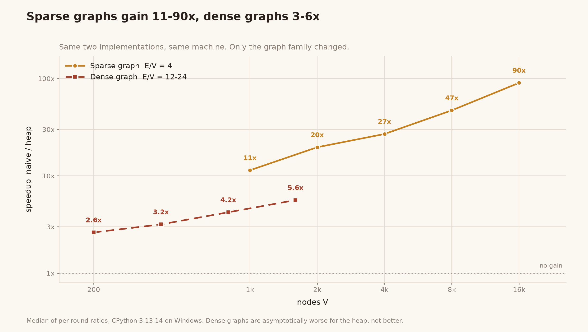
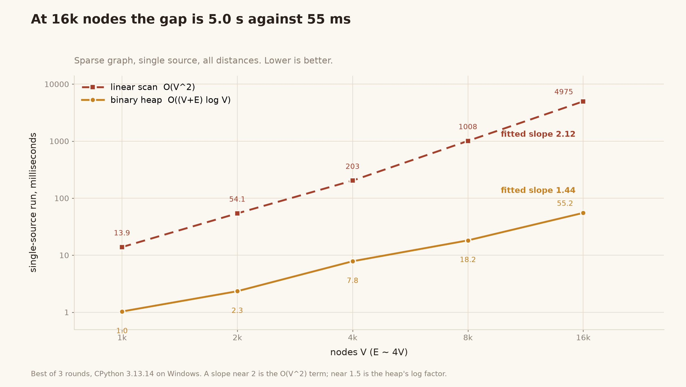
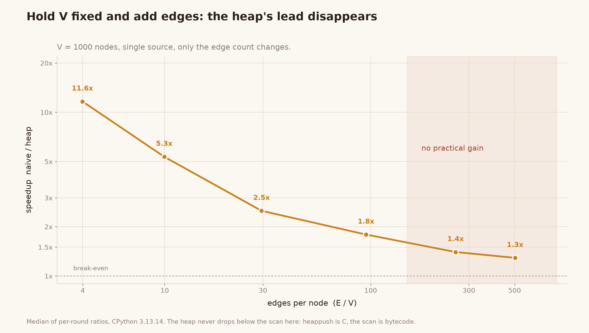

# dijkstra-opt-lab — 从线性扫描到二叉堆，以及堆在什么时候不管用

同一个算法，换一个数据结构，加速比可以从 **90 倍**变成 **3 倍** —— 取决于图长什么样。
这份仓库把两种实现放在同一台机器、同一套测量协议下跑，回答一个具体问题：

> 堆版 Dijkstra 到底快多少？在什么图上快？什么图上白搭？

顺带记录了一个常见错误：**"堆版在稠密图上更快"是错的**。稠密图上堆版的渐近复杂度反而更差。

```
稀疏图 E/V ≈ 4     11x → 90x（V 从 1k 到 16k）
稠密图 E/V ≈ 12-24  2.6x → 5.6x
固定 V=1000 扫密度  11.6x → 1.3x（E/V 从 4 到 503）
```

## 一、同一份代码，三种图



横轴是节点数，纵轴是 `naive 耗时 / heap 耗时`。两条线用的是**完全相同的两个函数**，
唯一变量是图的边密度。稀疏图（`E/V ≈ 4`，随机环 + 额外边，保证全节点可达）一路涨到 90 倍；
稠密图（`E/V ≈ 12-24`）爬到 5.6 倍就基本平了。



换成绝对耗时看得更清楚：naive 的拟合斜率 **2.12**，heap 是 **1.44**。
斜率差就是复杂度差 —— 前者是 `O(V²)` 项在主导，后者是 `log V` 因子。

## 二、堆什么时候失效



固定 `V = 1000`，只加边。加速比单调下滑：

| E/V | naive | heap | 加速比 |
|---:|---:|---:|---:|
| 4.0 | 13.9 ms | 1.2 ms | **11.6x** |
| 9.9 | 17.5 ms | 2.8 ms | 5.4x |
| 29.5 | 20.1 ms | 5.1 ms | 2.5x |
| 95.0 | 40.0 ms | 23.3 ms | 1.8x |
| 258.7 | 83.4 ms | 58.0 ms | 1.4x |
| 503.2 | 152.5 ms | 116.5 ms | 1.3x |

两个观察，第二个更值得记住：

1. **稠密图上堆版的优势会塌缩成一个常数。** 每条边都要一次 `heappush`，而线性扫描从不
   为它不松弛的边付钱 —— 边越密，这个不对称越明显。
2. **在 CPython 里它不会跌破 1.0。** `heappush` 是 C 实现，线性扫描是字节码循环，
   常数因子把复杂度差距吃掉了。所以实测结论是"没收益"，不是"变慢"。

教科书结论依然成立（CLRS 第 24.3 节）：**稠密图该用数组实现 `O(V²)`，稀疏图才用堆。**
只是在实际 Python 里，稠密图的代价表现为"白忙"，而不是"倒亏"。

## 三、完整数据

`python benchmark.py` 的原样输出（CPython 3.13.14 / Windows / 单机单次）：

| 图族 | V | E | E/V | naive | heap | 负边校验占比 | 加速比 | 轮内范围 |
|---|---:|---:|---:|---:|---:|---:|---:|---|
| sparse | 1 000 | 3 993 | 3.99 | 13.88 ms | 1.03 ms | 11.4% | **11.4x** | 11.2-13.5 |
| sparse | 2 000 | 7 990 | 4.00 | 54.12 ms | 2.34 ms | 13.3% | 19.7x | 12.8-23.2 |
| sparse | 4 000 | 15 986 | 4.00 | 203.32 ms | 7.83 ms | 7.8% | 26.9x | 16.2-28.1 |
| sparse | 8 000 | 31 988 | 4.00 | 1 008.04 ms | 18.19 ms | 9.4% | 47.1x | 39.7-55.4 |
| sparse | 16 000 | 63 994 | 4.00 | 4 975.02 ms | 55.18 ms | 11.1% | **90.2x** | 77.2-93.9 |
| dense | 200 | 2 416 | 12.08 | 0.75 ms | 0.29 ms | 13.3% | 2.6x | 2.4-2.7 |
| dense | 400 | 8 001 | 20.00 | 2.88 ms | 0.89 ms | 11.6% | 3.2x | 3.2-3.2 |
| dense | 800 | 19 006 | 23.76 | 10.83 ms | 2.41 ms | 11.5% | 4.2x | 3.5-4.6 |
| dense | 1 600 | 30 594 | 19.12 | 40.33 ms | 6.62 ms | 7.6% | 5.6x | 4.5-6.2 |

"轮内范围"是同一次运行里各轮比值的跨度。**跨机器、跨运行的波动比这个大得多** —— 同一份
代码跑四次独立运行，16k 那行分别测出 75x、84x、90x（第四次已在 `results.json`）。
绝对耗时不可跨轮比较，只有比值能扛住漂移。

"负边校验占比"是安全检查的代价，见下一节。

## 四、这个包修掉的四个缺陷

两种实现来自一份常见的教学对照代码。原版有四处会**静默出错**的地方，本仓库都补上了，
并各自配了回归测试。

### 1. 同一个模块里两个函数对负边的态度不一致

`dijkstra_optimized` 检查负边，`dijkstra_optimized_all` 不检查。于是同一张图，
一个函数抛 `ValueError`，另一个返回错误答案：

```python
G = {1: {2: 1.0, 3: 2.0}, 2: {4: 1.0}, 3: {2: -5.0}, 4: {}}
# 1 -> 4 的真实最短路是 1->3->2->4 = 2 + (-5) + 1 = -2
dijkstra_optimized_all(G, 1)   # {'1': 0.0, '2': -3.0, '3': 2.0, '4': 2.0}  ← 错，且不报错
```

现在四个入口共用 `_graph.validate_weights()`，**校验是全图预扫描**而不是松弛时惰性检查 ——
惰性检查会让"报不报错"取决于遍历顺序，同一个图换个起点就静默通过了。

### 2. 堆里存 `(距离, 节点)` 会在混合类型节点上崩

距离相等时 Python 要比较元组第二项。节点类型不统一就 `TypeError`：

```python
G = {"a": {"b": 1.0, 2: 1.0}, "b": {}, 2: {}}
# TypeError: '<' not supported between instances of 'int' and 'str'
```

改成 `(距离, 序号, 节点)` 三段元组，中间项是 `itertools.count()`。这个 bug 是优化版
**独有**的 —— 线性扫描版在同一张图上完全正常，属于"优化引入的退化"。

### 3. `end=None` 返回 `([], 0.0)`

`0.0` 是编出来的距离。任何写成 `path, dist = f(g, s)` 的调用方都会把它当成真实答案继续算。
现在直接抛 `ValueError`，单源距离请走 `*_all`。

### 4. 两个 `_all` 返回的键集不同

naive 版返回全部节点（不可达的映射到 `inf`），heap 版只返回可达节点。README 把"只处理可达
节点"写成了优化点，却没说是 **breaking change** —— 别人替换实现后，`d[不可达节点]`
会从返回 `inf` 变成 `KeyError`。

现在两边默认都只返回可达节点（对齐 networkx 的 `single_source_dijkstra_path_length`），
需要全集就传 `include_unreachable=True`。

### 顺带清掉的

- 死代码 `if start not in graph and (...): pass`，什么都没做。
- `optimized({}, 'x', 'x')` 返回 `(['x'], 0.0)`，而 naive 返回 `([], inf)` —— 已统一。
- `end` 不在图里时 naive 版 `predecessor[end]` 会 `KeyError` —— 已修。

### 修 bug 是有代价的

上面第 1 条的全图预扫描不是免费的。它在 heap 版耗时里占 **8-13%**（表里那列），
因为 heap 版本身只要几十毫秒，而扫描 O(V+E) 一遍是固定的。

做了两件事控制成本：

- 内层循环交给 C：`min(neighbours.values())` 比双层 `for` 快约 2 倍（16k 节点 12.1 ms → 6.2 ms）。
- 留了 `check_weights=False` 的口子。如果你自己在建图时已经保证权重非负，可以跳过一次扫描 ——
  同一张图只该校验一次，不是每次查询都校验。

## 五、跑起来

```bash
python dijkstra_optimized.py      # 小例子
python benchmark.py               # 完整基准，约 40 秒，写 results.json
python benchmark.py --quick       # 缩小规模，约 5 秒
python scripts/make_charts.py     # 从 results.json 出图（需要 matplotlib）
python -m unittest discover -s tests -t .    # 25 个测试，0.03 秒
```

无第三方运行时依赖，纯标准库。

## 六、API

```python
from dijkstra_optimized import dijkstra_optimized, dijkstra_optimized_all
from dijkstra_naive import dijkstra_naive, dijkstra_naive_all

dijkstra_optimized(graph, start, end)
# -> (path: list, distance: float)   空 list + inf 表示不可达

dijkstra_optimized_all(graph, start, include_unreachable=False)
# -> {node: distance}               默认只含可达节点
```

`dijkstra_naive*` 签名完全一致，返回完全一致 —— 差别只在快慢。

四个函数都接受 `check_weights=True/False`，控制是否做负边预扫描。

## 七、复杂度

| 实现 | 时间 | 空间 | 该用的场景 |
|---|---|---|---|
| 线性扫描（数组式） | `O(V² + E)` | `O(V)` | 稠密图，`E = Θ(V²)` |
| 二叉堆 + 惰性删除 | `O((V + E) log V)` | `O(V)` | 稀疏图，`E = O(V)` |

把 `E = Θ(V²)` 代进第二行：`O(V² log V)` —— 比第一行的 `O(V²)` **更大**。所以"稠密图也用堆"
在渐近意义上站不住。本仓库的实测（第 2 节）验证了这一点在 Python 里的真实表现。

堆版采用**惰性删除**：`heapq` 没有高效的 decrease-key，改进距离时直接再入堆一条，
出堆时靠 `settled` 集合丢弃过期条目。实践中比手动维护位置索引更快、代码更短。

## 八、测量方法

结果表里每一个数字都遵循同三条：

1. **轮内交错。** 每轮把 naive 和 heap 各跑一遍，报**逐轮比值的中位数**。绝对耗时在
   两次运行之间能漂 40%（16k 那行实测 64x → 90x），但同轮比值稳定。
2. **best-of-N。** 噪声只会让单次变慢，所以取最小值。
3. **两个臂都预热。** 只预热 fast arm 会系统性高估比值 —— 实测约 10%。

另外，稀疏图用**随机环 + 额外边**构造，保证全节点可达。这不是洁癖：naive 版遇到
"剩下全是 inf" 会 `break` 提前退出，图不连通时 `O(V²)` 项根本不会发生，会得出
"naive 也没那么慢"的假象。

`benchmark.py` 里还有一个**正确性闸门**：跑性能之前先对拍 6 个源点的 1260 个距离值、
90 条重建路径，检查每条路径的边都真实存在且权重和等于报告的距离。不做这步，
快而错是没有意义的。

## 九、文件结构

| 路径 | 内容 |
|---|---|
| `dijkstra_naive.py` | 线性扫描对照版，故意保留 `O(V²)`（别"修"它） |
| `dijkstra_optimized.py` | 二叉堆 + 惰性删除 |
| `_graph.py` | 两个实现共用的校验与边界逻辑，保证契约一致 |
| `graphs.py` | 稀疏（环+随机边）/ 稠密图生成器 |
| `benchmark.py` | 正确性闸门 + 分组基准 + 密度扫描 |
| `tests/test_dijkstra.py` | 25 个测试，按缺陷分类组织 |
| `scripts/make_charts.py` | 从 `results.json` 出图 |
| `results.json` | 基准原始输出，图上的数字全部来自这里 |
| `docs/review-original.md` | 对原始包的审阅记录（缺陷复现与首次测量） |

图不是手绘的。`make_charts.py` 只读 `results.json`，所以图片不会和测量结果脱节。

## 许可证

MIT，见 [LICENSE](LICENSE)。
